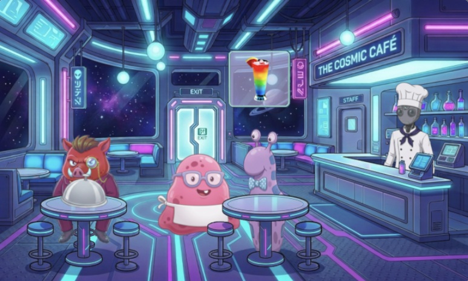
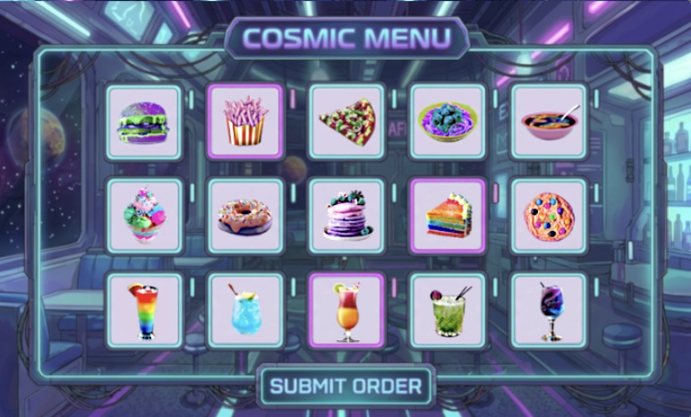

# Jelly at the Cosmic Cafe

This is a fun little alien themed game to test your memory. The goal is to help Jelly the waitress remember each of her customers' orders so she can earn a permanent role at the Cosmic Cafe. 

It is played using mouse clicks which control Jelly's movement and allow menu items to be selected. The difficulty increases with each new customer and the player has to get three out of four orders correct to win the game.

  <a href="https://codeinplace.stanford.edu/cip6/share/joxIqXXv4O3JT3IMPtLn"><b>Play it here</b></a>

Built for Stanford's Code in Place course using the course's online editor and graphics library.

  

  

  

